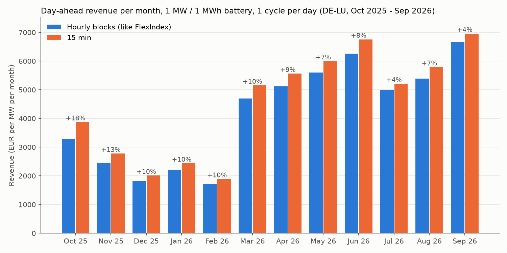

## Hourly blocks vs 15 minutes in the day-ahead step of the FlexIndex model

Fork of [FlexPwr/bess-optimizer](https://github.com/FlexPwr/bess-optimizer) (GPL-3.0). The original README is below.

### Question

First I wanted to understand how the FlexIndex model works. Then I found that its day-ahead step forces the battery into hourly blocks, although the day-ahead auction trades 15-minute products since 1 October 2025. I wanted to know how much more revenue a battery makes if it can use the 15-minute products.

### Approach

- Downloaded the 15-minute day-ahead prices for DE-LU (SMARD, via the Energy-Charts API) for 1 Oct 2025 to 30 Sep 2026.
- Ran the day-ahead step of the original model for every day with the FlexIndex battery: 1 MW, 1 MWh, 1 cycle per day, perfect foresight. With hourly blocks and 15-minute prices, each hour earns the average of its four quarter-hour prices. This is also how FlexIndex calculates since October 2025.
- Checked that I get the same numbers as FlexPower: the 28-day moving average of my daily results matches the "DA Auction Revenue" of the FlexIndex within 0.001 EUR per day (296 days compared, `validate_flexindex.py`).
- Added a switch `hourly_blocks` to the day-ahead step and ran every day twice with the same prices: with hourly blocks (original) and without (free 15-minute positions).

### Result

| Day-ahead revenue, 1 MW / 1 MWh, 1 cycle per day | EUR/MW/year |
|---|---|
| Hourly blocks (like FlexIndex) | 50,475 |
| 15 minutes | 54,716 |
| Difference | +4,241 (+8.4 %) |

Annualised from 363 days (mean per day x 365). Daily values are in `results_daily.csv`.



- 15 minutes was never worse than hourly blocks (0 of 363 days), only better. It has to be like this: without the hourly block rule every hourly schedule is still allowed, plus many more.
- The monthly difference goes from +18 % (Oct 2025) down to +4 % (Jul and Sep 2026). Two possible reasons: traders got used to the 15-minute products, or the bigger price spreads in summer make the same gain a smaller share. One year of data cannot separate the two.

### Limits

- Day-ahead only. No intraday auction, intraday continuous or balancing markets, so the result is below the FlexIndex total.
- Perfect foresight: the model knows the real prices, so this is an upper bound. Price taker: the battery does not change the prices.
- Battery like the FlexIndex: 100 % efficiency, every day starts and ends empty. A bigger battery (e.g. 2 hours) would give different numbers.
- The two clock change days (26 Oct 2025 with 100 and 29 Mar 2026 with 92 quarter-hours) are left out, because the model only works with 96 quarter-hours. FlexIndex leaves them out too.
- One year of past data, it says nothing about the future.

### Next steps

- Add charge and discharge losses to the model.
- Test with a forecast instead of perfect foresight: plan tomorrow with a forecast (e.g. today's prices) and check the result with the real prices.

### Changes to the original code

Only `optimizer.py`:

- Line 20: solver GLPK -> HiGHS (`appsi_highs`), installed with pip, no extra program needed. `example.ipynb` gives the same result as before (130.25 EUR).
- Line 22: new parameter `hourly_blocks: bool = True`. Default is True, so existing code runs as before.
- Lines 168-181: `if hourly_blocks:` around the six hourly block constraints (1.8 / 1.9). With False these 144 equations are not added to the model.
- A note about the changes at the top of the file (GPL-3.0).

`requirements.txt` is updated for Python 3.12. All changes: [compare with the original](https://github.com/LativAfshar/bess-optimizer-15min/compare/0f98f98e5070c50926fb184e5b319c0715309cb1...main).

New files: `download_prices.py`, `one_day.py` (one test day), `run_year.py`, `validate_flexindex.py`, `plot_monthly.py`, `results_daily.csv`, `monthly_revenue.png`.

### How to run

```
python -m venv .venv
.venv\Scripts\activate
pip install -r requirements.txt
python download_prices.py
python run_year.py
python plot_monthly.py
```

`validate_flexindex.py` needs the FlexIndex CSV, which you can request on the [FlexIndex page](https://flex-power.energy/services/flex-trading/flex-index/). It is not part of this repo.

### Data and license

- Prices: Bundesnetzagentur | SMARD.de, licensed under [CC BY 4.0](https://creativecommons.org/licenses/by/4.0/), retrieved via the [Energy-Charts API](https://api.energy-charts.info) (Fraunhofer ISE) on 17 Oct 2026. Converted from JSON to CSV, values unchanged. Not stored in this repo, `download_prices.py` downloads them.
- Code: GPL-3.0-or-later like the original, see [LICENSE](LICENSE). Original model: Copyright (C) 2024 CF Flex Power GmbH.

---

## Original README (FlexPwr/bess-optimizer)

Note: this fork uses the HiGHS solver (`pip install highspy`) instead of GLPK.

## Implementation of the FlexPower Three Market BESS Optimization Model in Python using pyomo


This repository contains the Three Market Optimization model which is also used to calculate the [FlexIndex](https://flex-power.energy/services/flex-trading/flex-index/). 

The model calculates the optimal charge-discharge-schedule of a BESS (Battery Energy Storage System) by sequentially optimizing over three German markets: The Day-Ahead auction, the intraday auction and the intraday continuous market (approximated as ID1). The logic is explained in more detail [here](https://flex-power.energy/services/flex-trading/flex-index/). The optimizer is implemented using Pyomo, an open source optimization modelling package for Python.

With open-sourcing this, we want to help build a solid public knowledge base for flexbility optimization, which is available to anyone and can help push forward the whole flexibility market. If you build upon this model, or use it in some other way, we would be happy to see you contribute to this common goal as well. 

Note that you have to install the [GLPK solver](https://www.gnu.org/software/glpk/) on your machine to run the model. 

#### Contents 

• The file [optimizer.py](optimizer.py) includes the implementation of the BESS optimization for the DA Auction, ID Auction and ID Continuous markets. 

• The notebook [example.ipynb](example.ipynb) shows how the optimization works for an example day.

• [mathematical_formulation.pdf](mathematical_formulation.pdf) is a document, which includes the mathematical formulation of the optimization problem. It is meant to accompany the code implementation. The model constraints in the code and in the mathematical formulation are numbered accordingly. 

• [LICENSE](LICENSE) is the copyright license of this work.


#### Abbreviations

The formulation includes a number of abbreviations, below is a short list with explanations:

DAA:         Day-ahead Auction. In the German case this is the EPEX Day-ahead auction which takes place at 12:00h on the day before delivery.

IDA:         Intraday Auction. In the German case this is the EPEX Intraday auction which takes place at 15:00h on the day before delivery. 

IDC:         Intraday Continuous Market. Opens at 15:00h on the day before delivery and closes 5 minutes before delivery.

ID1:         The volume-weighted average price of all trades in a specific contract on the Intraday Continuous market.

SOC[q]:      State of Charge of a Battery at quarter q.

CHA[q]:      Charge rate of a Battery at quarter q.

DIS[q]:      Discharge rate of a Battery at quarter q.


